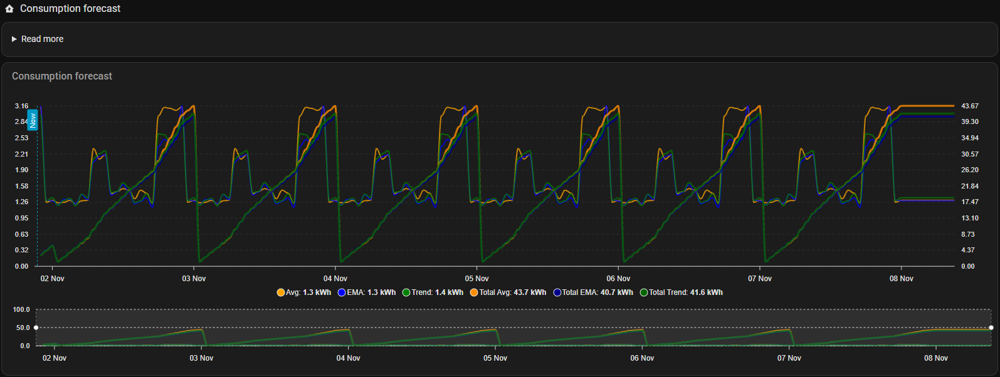
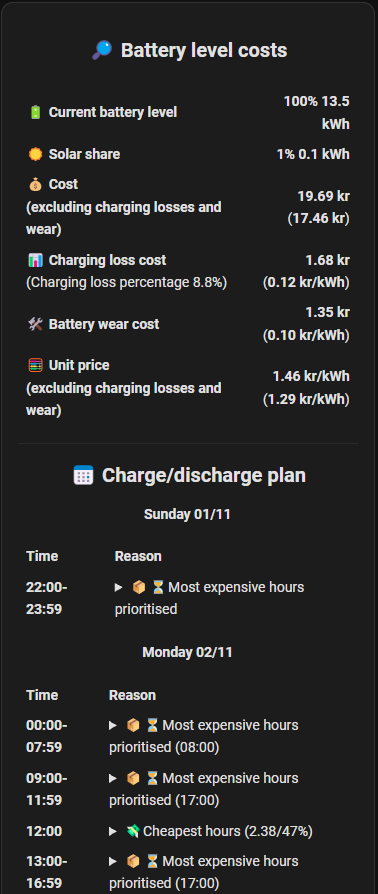

# How BattMind plans

This page explains the model behind the decisions. Read it when the battery does something you didn't expect.

## The loop

Every few minutes (the **interval**, default 5 min) BattMind:

1. reads the battery level, the prices, the consumption history, the solar forecast and the settings
2. recalculates the plan – but only when one of these has changed since the last time
3. sets `sensor.<prefix>_powerwall_action` to what the battery should do **right now**

The plan covers **days to plan** (default 3: today and the next two days). It is shown on the dashboard
with a reason for every hour.

Because the plan is recalculated from the new battery level every interval, a charge hour stops once its
planned kWh are in the battery, and a charge planned for half an hour really is half an hour.

## What goes into the plan

### Consumption forecast

BattMind stores the house's consumption for every hour of the day (without battery charging and ignored
consumers, default the last 15 days). The forecast for an hour is made from those values with the
**forecast type** you select:

| Type | Good for |
|---|---|
| **EMA** (default) | most houses: recent days count more, but one odd day doesn't take over |
| **Trend** | consumption that steadily rises or falls (e.g. into winter) |
| **Average** | a very regular consumption |

The forecast is then corrected by how the last 48 hours went: if the house used 10 % more than forecast,
the forecast is raised 10 %. The [analysis](dashboard-analysis.md#forecast-accuracy) shows which type
would have been most accurate for your house.

  

### Solar forecast

The plan uses the **solar surplus**: solar production minus the house's consumption. Two sources are combined:

- **Solcast:** the forecast production minus the forecast consumption
- **Own history:** BattMind stores the measured surplus per hour and per weather score (cloud cover, UV and
  temperature from the weather forecast). For a forecast hour it looks up the hours with the same weather score

With both, Solcast counts 75 % and the history 25 %. Without Solcast, the history alone is used, so the
forecast also works without Solcast after a few weeks.

In an hour with solar surplus the sun covers the house, so the battery isn't planned to discharge in it.

### Prices

Buy and sell prices per hour (or per 15 minutes) from Energi Data Service and/or Strømligning, incl.
tariffs, refund and sell fee.

**Forecast prices** (e.g. Carnot) get a small adder of 0.033 kr per day ahead, so the plan prefers known
prices. With the switch *Correct the price forecast* on (default, *Settings → Control*), they are also corrected with how far off the
forecast was the last 30 days for that day ahead: if the forecast 2 days ahead was 0.15 kr too high on
average, the plan subtracts 0.15 kr. A day ahead is only corrected after 7 days of measurements, and by at
most ±0.50 kr. The [price forecast analysis](dashboard-analysis.md#price-forecast) shows the measurements
and the correction used.

BattMind also keeps its **own price database**: every day the buy and sell prices from the price
integration are stored per hour of the day and weekday (only real prices – never the estimates below). It
is used when prices are missing:

- **Hours without a price:** every hour of the plan (days to plan) that the price integration has no price
  for gets the forecast of the same hour and weekday from the database. Without a price forecast (e.g.
  Carnot), the published prices usually end tomorrow at midnight, and the rest of the plan uses the database.
- **The price integration is offline:** the last prices are kept for 2 hours. After that BattMind plans
  the next 7 days with prices from the database, so the battery keeps working until the integration is back.
- **The cost of the energy in the battery** for hours where the price integration has no price any more.
- **The value of the solar surplus** in the solar forecast from the stored history.

The hours with prices from the database are listed under *Using offline prices for some hours* in the
overview. The database is part of the [backup](../README.md#backup-export-and-import-of-data) and is
imported from the PyScript version.

## The cost of a kWh from the battery

All decisions compare a price now with what a kWh from the battery costs. It is made of three parts:

1. **The energy itself.** A grid kWh costs the buy price it was charged at. A solar kWh costs what it
   would have been sold for – that is what you give up by storing it. BattMind keeps a running average
   of what is in the battery.
2. **Loss.** The configured (or measured) round trip loss. 1 kWh out of the battery costs
   `price ÷ (1 − loss)`. The loss is split evenly between charging and discharging: with 10 % loss,
   5 kWh from the grid become 4.74 kWh in the battery and 4.5 kWh back out.

   Separate charging and discharging efficiency curves can replace that split. Each curve maps AC power
   in W to efficiency in percent. BattMind measures them itself from the battery power and the changes
   of the battery level (see [Battery efficiency](dashboard-analysis.md#battery-efficiency)); a curve
   entered in the setup takes precedence over the measured one. BattMind interpolates linearly between
   points and uses the nearest endpoint outside the range. The whole-period optimiser evaluates the
   efficiency at its actual planned power; the rule planner and cost calculation use the efficiency at
   the configured maximum power. Until a power step has enough measurements, the round-trip model above
   is used.
3. **Wear** per kWh taken out.

**Example** with 10 % loss and 0.10 kr/kWh wear:

| Charged at | Energy | Loss | Wear | Cost of 1 kWh out |
|---|---|---|---|---|
| grid, 0.80 kr/kWh | 0.80 | 0.80 × 0.1 ÷ 0.9 = 0.09 | 0.10 | **0.99 kr** |
| solar, sold for 0.40 kr/kWh | 0.40 | 0.04 | 0.10 | **0.54 kr** |

So charging from the grid at 0.80 only pays when the energy is used in hours that cost more than 0.99 kr –
plus the **min. profit per kWh** you have set.

The overview shows what the energy in the battery has cost right now, split into energy, charging loss and wear:

  

## The rules of thumb BattMind always keeps

- **Solar first.** Solar surplus charges the battery before the grid. Grid charging may not take charge
  power the sun uses in that hour, nor the room the sun fills later. The one exception: when the solar that
  would be pushed out is sold for more than the grid kWh costs (e.g. at negative buy prices).
- **One thing per hour.** The battery never charges and discharges in the same hour. If an hour has both
  a charge and a sale, the charge wins.
- **The profit requirements apply to everything.** **Min. profit per kWh** and **min. total profit**
  apply to every charge, discharge and sale, and **min. kWh for export** to every sale.
- **The horizon follows the plan.** With a big battery or a low consumption the energy lasts days, so the
  rules look until the battery is empty or full again – not only until midnight (unless
  [use midnight battery level](rules/selling.md#use-midnight-battery-level) is on).

## Rules and optimisation

There are two ways to decide what the battery does each hour:

- **The whole period optimisation** (default) calculates the cheapest action for every hour of the whole
  plan at once. The rules still run alongside it: each action the optimisation chooses is shown as the rule
  it corresponds to, and a rule switched off forbids that kind of action. See
  [Whole period optimisation](rules/optimizer.md).
- **The rules** run one after another and build the plan step by step. They control the battery when the
  optimisation is switched off, and they are the fallback if it fails.

### When the rules control the battery

With *Control the battery with the whole period optimisation* off, the plan is built like this:

1. **The starting point:** the battery may discharge in every hour, and it charges only from solar.
2. **Charging and holding back**, day by day, in this order:
   1. 🚫 [Profit only](rules/discharging.md#-profit-only) – blocks discharging where the battery's energy costs more than the price
   2. 🎁 [Negative prices](rules/charging.md#-negative-prices)
   3. 💸 [Cheapest periods](rules/charging.md#-cheapest-periods) (incl. *fill up*)
   4. 🔥 [Most expensive periods](rules/charging.md#-most-expensive-periods)
   5. 🩹 [Required before max level](rules/charging.md#-required-before-max-level)
   6. ⏳ [Prioritise by energy cost](rules/discharging.md#-prioritise-by-energy-cost)
3. **Selling**, day by day, in this order:
   1. 🌄 [Before the sun](rules/discharging.md#-before-the-sun)
   2. 🤑 [Maximise profit](rules/selling.md#-maximise-profit)
   3. 📤 [Sell excess kWh](rules/selling.md#-sell-excess-kwh)
   4. 🔁 [Buy to sell](rules/charging.md#-buy-to-sell)
   5. 🕰️ [Max. age of kWh](rules/discharging.md#-max-age-of-kwh)
4. 🎛️ [Optimise solar charging](rules/solar.md#-optimise-solar-charging) moves solar charging to the cheap
   solar hours.

After every rule the battery level forecast is recalculated, so the next rule builds on what the earlier
ones planned. The order matters:

- **Earlier rules come first.** A charge hour that *Cheapest periods* has filled only has the remaining
  charge power left for *Most expensive periods*, and *Maximise profit* only sells what the charging
  rules have put in the battery.
- **Each rule only sees the plan so far.** A sale doesn't make an earlier charge rule charge more, and a
  rule can't undo what an earlier rule decided. This is the main difference from the optimisation, which
  weighs all hours against each other at once.
- **A rule switched off is simply skipped.** With every rule off, the battery runs in normal operation
  (`discharge_allowed`) all the time and only charges from solar.

The optimisation is still calculated, so the overview can compare the rule plan with it.

## From plan to action

Every interval, the action for the current hour is chosen in this order:

| Priority | When | Action |
|---|---|---|
| 1 | the hour is a planned charge hour | `grid_charging` |
| 2 | the current 15-minute period is a planned sale | `force_discharge` |
| 3 | the battery may discharge in this hour (also old energy, see [max. age of kWh](rules/discharging.md#-max-age-of-kwh)) | `discharge_allowed` |
| 4 | solar charging is blocked in this hour | `blocked_solar_charge` |
| 5 | none of the above: the energy is saved for later | `force_solar_only_charging` |

What each action should make the inverter do is described under [Actions](actions.md).

## When something goes wrong

- **Prices missing:** single hours are filled from the [price database](#prices). If all prices are gone,
  BattMind keeps the last prices for 2 hours, then plans entirely with the database.
- **A rule fails:** the other rules still run, and you get a notification with the error.
- **The optimisation fails:** the rules control the battery.
- **The whole calculation fails 3 times in a row:** the integration is reloaded. Until then, the last action is kept.
