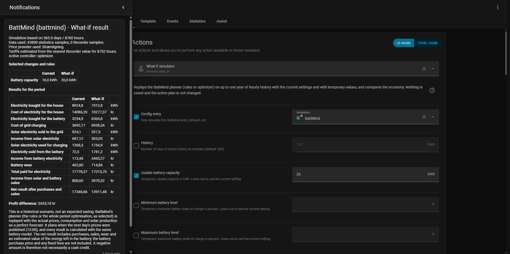

# What-if simulator

The **battmind.what_if** action answers questions such as:

- Would a larger battery have saved more money during the last year?
- How much would more charge/discharge power have improved the economy?
- How much do loss, wear or the reserve affect the result?
- Would the rules have done better or worse than the whole period optimisation?
- What would another rule switch, threshold or excluded selling hours have meant?

It replays the BattMind planner on your own hourly history twice: once with the current configuration
and settings, and once with the values you change. Both use the same hourly Home Assistant long-term
statistics for consumption, solar production and buy/sell prices. By default it uses up to 365 days.
Nothing is saved, the active plan is not changed, and no inverter command is sent.

## How the replay works

A separate planner (not the live one, its plan or its databases) plans every historical day with the
real BattMind rules and the whole period optimisation, exactly as the live planner does:

- **Prices:** only the real recorded prices of the configured buy/sell entities (Strømligning first,
  Energi Data Service for the hours without Strømligning history). The planner runs when the prices of
  the next day are published (13:00) and plans until the end of the next day; that plan is executed
  until the next publication. A history that starts before 13:00 is first planned with the prices of
  its own day. No price forecast or offline prices are used.
- **Consumption and solar:** the actual consumption (without ignored consumers) and the actual solar
  surplus of each hour are the forecast, so the plan is not disturbed by a bad forecast. The forecast
  type and the price forecast correction therefore have no effect in the simulator.
- **Controller:** with **optimizer_control** on, the hours are executed with the whole period
  optimisation, otherwise with the rule plan, both converted to battery actions the same way as the live
  battery control. The rules can only use what they are allowed to by the rule switches.
- **Execution:** every hour is calculated with the actual consumption and solar production and the
  same battery model (limits, charge/discharge efficiency, wear), so the two columns can be compared.
  The cost and age of the energy in the battery come from the simulated charging, the same as the live
  charging history.
- **Round-trip loss:** the replay has no charging history, so the round-trip loss currently measured
  by BattMind (or the configured one) is used for both columns.

## Run a simulation

Open **Developer tools → Actions**, select **BattMind: What-if simulator**, choose the BattMind config
entry and fill only the values you want to replace. Run the action to receive a persistent notification
with a two-column comparison of the configured values and the what-if scenario; only values and rule
switches that differ from the current setup are listed. The action also keeps
returning the full simulation response for automations and scripts. A progress notification is shown
while history is loaded and the simulation runs. While the history is loaded it shows the current step
(long-term statistics, raw Recorder history, Energi Data Service tariffs, hourly values, preparing the
simulation) and the elapsed seconds, updated when the step changes and at least every 10 seconds. When
the simulation starts it is updated at most every 10 seconds with the percentage done and the simulated
days, and the finished result (or an error) replaces that same notification.

  

Example action:

    action: battmind.what_if
    data:
      config_entry_id: YOUR_CONFIG_ENTRY_ID
      history_days: 365
      battery_size: 20
      max_charging_power: 8000
      max_discharging_power: 8000
      round_trip_loss: 5
      wear_cost_per_kwh: 0.1
      usage_reserve: 30
      optimizer_control: false
      most_profit: false
      min_profit_per_kwh: 0.25
      exclude_sell_hours: "17,18,19"

All fields are optional; a field you leave out uses the current setting. Power is in W, battery capacity
in kWh, and battery levels and round-trip loss are percentages.

| Group | Fields |
|---|---|
| Battery | **battery_size**, **minimum_level**, **maximum_level**, **starting_level**, **max_charging_power**, **max_discharging_power**, **round_trip_loss**, **wear_cost_per_kwh** |
| Controller | **optimizer_control** (on: whole period optimisation, off: rules), **use_midnight_battery_level**, **solar_charging**, **enhance_battery_efficiency** |
| Profit and selling | **min_profit_per_kwh**, **min_total_profit**, **min_sell_kwh**, **usage_reserve**, **exclude_sell_hours** |
| Charging rules | **cheapest_hour_fill_planner**, **cheapest_hour_fill_up**, **cheap_price_periods**, **cheapest_price_rise_threshold**, **cheap_price_period_rise_threshold**, **most_expensive_planner**, **needed_before_max_level_planner**, **negative_price_planner**, **grid_charge_to_sell** |
| Discharging and selling rules | **only_discharge_on_profit**, **prioritize_discharge_hours_by_energy_cost**, **discharge_before_solar**, **most_profit**, **sell_excess_kwh_available**, **force_powerwall_max_hours_old_discharge**, **powerwall_max_hours_old** |
| Solar | **optimize_solar_charging** |

Setting **round_trip_loss** temporarily replaces the configured or measured efficiency curves (as if
**enhance_battery_efficiency** were off). The rule thresholds (cheap price periods, rise thresholds,
maximum kWh age) only change the result when the rules control the battery. The notification shows
the current value beside the scenario value for each setting you changed.

## Reading the response

| Part | Meaning |
|---|---|
| **period** | first/last hour and the amount of historical data actually used |
| **data_sources** | counts of used entity-hour samples from long-term statistics and raw Recorder fallback |
| **price_provider** | configured provider with the most complete matching hourly data |
| **tariff_estimated_hours** | hours where the closest recorded tariff value was used instead of an exact-hour value |
| **tariff_unavailable_hours** | hours left out of the simulation because required tariff history was unavailable |
| **current_assumptions** | battery values, settings, rule switches (**rules**) and controller (**control_mode**) of the current comparison |
| **assumptions** | the same for the scenario |
| **current** | historical economy with the current configuration and settings |
| **scenario** | economy with the changed values |
| **difference.profit** | scenario profit minus current profit; positive is better |
| **difference.bill** | scenario bill minus current bill; negative is better |
| **coverage** | only when at least 24 hours of the requested period have no data: requested and missing hours, the hours missing before the first simulated hour and inside the period (**gap_hours**), the entity whose history starts last (**limited_by**) and the requested/simulated hours per month |
| **estimate** | the rough estimate of the whole requested period (see below), or empty when there is too little data |

Both **current** and **scenario** contain the net result with and without the battery, expected profit,
charged grid/solar energy, energy delivered to the house, sales, wear, the final battery level and the
profit, net result with the battery (**bill**) and simulated hours per calendar month (**months**). The
change of the battery level within a month is valued like the energy left at the end, so the months add
up to the profit and the net result.

## Less history than requested

When less history than requested is available, for example 65 of 100 days or 200 of 365 days, the
results above are always only the reliable figures: they are calculated from the simulated hours
alone. The notification then also says how many days are missing, which entity has no history
further back (and from which date its data starts), and how many hours inside the period are missing
because of gaps or missing tariffs.

Below the reliable results, a separate, clearly marked section estimates the net result after purchases
and sales (with the battery) of the whole requested period for both columns: the reliable net result,
an estimate for the missing days and the total, and the improvement of the scenario (a lower net result
is better). Each missing hour gets the average net result per hour of the same calendar month (any year) when
that month has at least 7 days of simulated data (or a quarter of a shorter requested period); otherwise
it gets the average of the nearest calendar month with enough data, and the notification lists those
months. The estimate is only shown when at least half of the requested hours were simulated; otherwise
the notification says that there is too little data. Season, prices and consumption of the missing days
are unknown, so the estimate is a rough approximation and not an expected saving.
A negative net result is not necessarily a cash credit: the calculation includes an estimated value for
energy remaining in the battery, but excludes the battery purchase price and any fixed fees.

This is a hindsight calculation, not a forecast or guarantee: the planner knows the actual consumption
and solar production of the planned hours, so treat the result as an optimistic historical benchmark
rather than expected savings or battery payback. It uses Home Assistant Recorder's
long-term statistics first and fills missing hourly values only from fully covered, time-weighted raw
Recorder state history for the same configured entities. Unknown/unavailable state periods are never
filled or assumed. Hours without data for every required entity are skipped, so a gap does not discard
older valid history. The calculation treats each continuous section separated by a gap independently:
the first section uses the selected starting level and later sections restart at the battery's minimum
level rather than carrying an unknown state of charge across missing data. If both Strømligning and
Energi Data Service are configured, each hour uses Strømligning's price history first and falls back
to Energi Data Service for hours where Strømligning has no history, the same priority as the planner.
Buy and sell prices for an hour always come from the same provider, and the result reports how many
hours each provider supplied. The
simulator does not use BattMind's offline price database or assume that the buy price was earned when
selling.

Historical sell prices use BattMind's normal sell-price formula (the tariffs in the price, and the
selling costs: sell fee plus Energinet's net and system tariff), with the recorded tax/tariff
components. Energi Data Service tariff schedules are read from timestamped
Recorder attributes; Strømligning tariff sensors use the nearest recorded hourly value. When a
tariff sample is missing at the exact simulation hour, the closest available sample is used and the
notification reports the number of estimated hours. Energi Data Service does not save its tariff
attribute in the Recorder, so a schedule is only available if another Recorder setup kept it. A sell
sensor without a tariff attribute (tariffs disabled in Energi Data Service, a raw price) needs no
tariffs, the same as in the live plan; BattMind checks this from the sensor's current state. Its
selling costs use the net and system tariff of the buy sensor's current state for every hour. If the
tariffs of an hour are still unknown, the hour uses the next price provider with prices and tariffs.
If no provider has them, the hour is left out like missing data: there are no purchases or sales in
that hour, rather than purchases without the matching sales.

The live planner plans again every few minutes from the measured battery level; the replay plans once
per published price day, which gives the same plan as long as the forecast is right (it is, in the
replay). A year of history means a few hundred planner runs per column, so the simulation can take a
few minutes; the progress notification is shown meanwhile.
The displayed day count is based on hourly samples, not calendar dates. Without a configured historical
sell-price entity, variable export revenue is treated as zero (a fixed configured solar sell price is
still used). Home Assistant may provide fewer days than requested if older statistics are unavailable;
see [Less history than requested](#less-history-than-requested).
